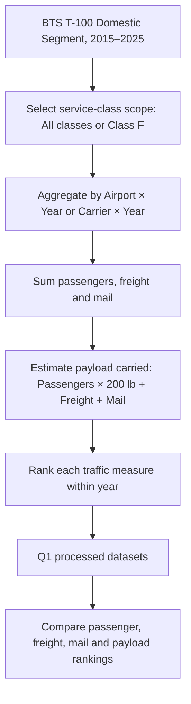
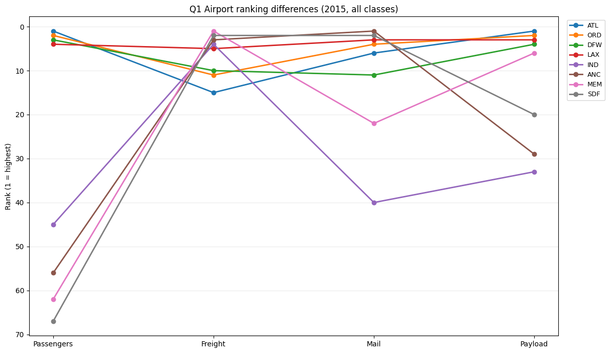
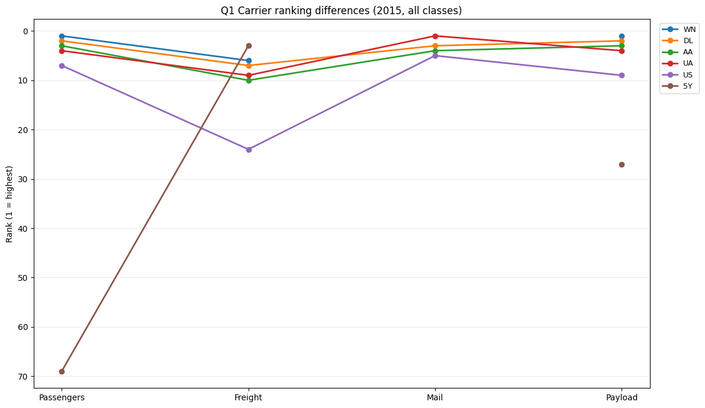
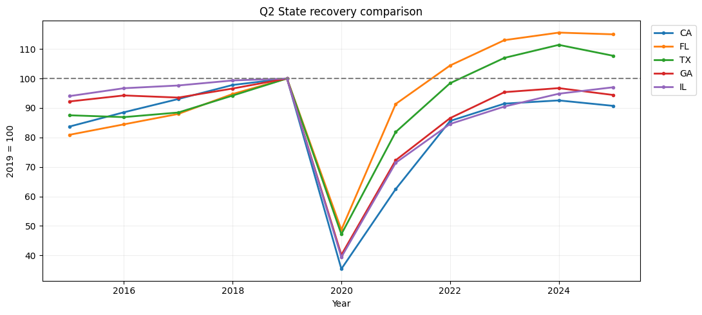
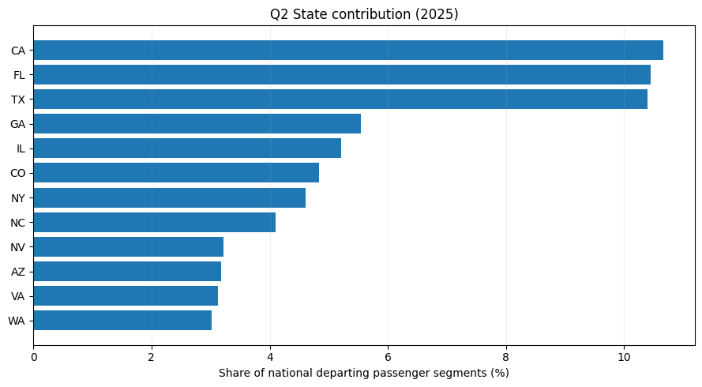
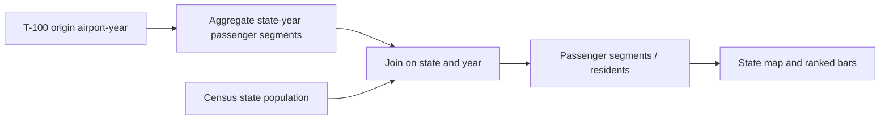
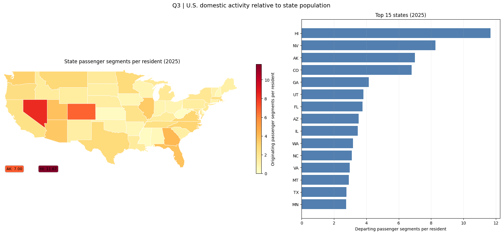
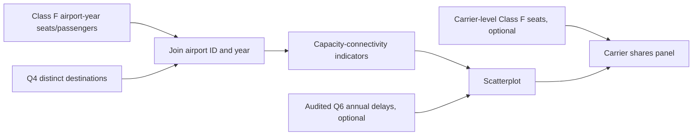
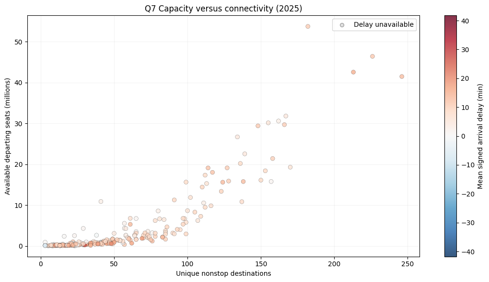
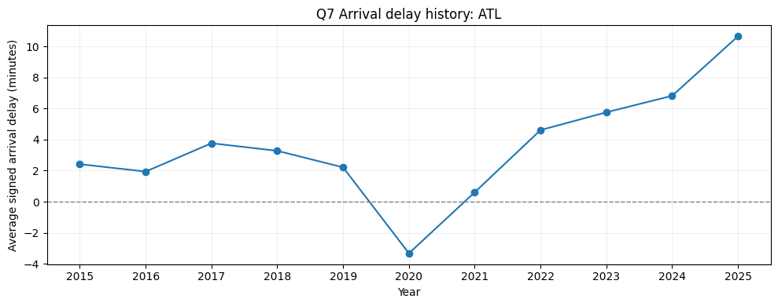

# Milestone 2: Data Handling and Visualization Sketches

**Team 8: Gacha**  
**Members:** Ronak Pradhan (rp4803), Joe Perinchery (jp8276)  
**Course:** Information Visualization  
**Repository:** https://github.com/WebXoX/Info-Viz-Team-Gacha (confirm branch and access before submitting)

> **Draft for team review, not a completed submission.** Tables below are authentic excerpts from the EDA output, while sketches are AI-assisted **wireframe drafts**, not team-produced original sketches. Replace or approve/redraw these according to the course's AI-use and original-sketch requirements. Verify relative links after moving files into the repository.

## 1. Project overview and revisions

Our project explores U.S. domestic aviation from **2015 through 2025**, using complete calendar years. Partial 2026 data are excluded from annual comparisons. The main audience is **airline network and operations planners**, with airport operators and government planners as secondary audiences. The dashboard is designed to move from national context to state and airport comparisons, then to routes, airport types, and potential capacity–connectivity mismatches.

**Changes since the original proposal:** Q1 shifts from a single-year, multiple-measure ranking to tracking airport and carrier **passenger ranking changes over time** (freight and mail remain available in EDA). Q2 emphasizes national-to-local recovery comparisons. Q3 uses **states and D.C.**, not metropolitan areas, because the available Census population data and airport mapping support consistent state-level comparisons. Q5 focuses on the distribution of passenger activity across the project's fixed airport-size groups. Q7 has been narrowed from presumed “missed opportunities” to **potential capacity/connectivity mismatches**, supported by 2019 connectivity recovery and optional delay/carrier context. **Q6's visualization remains undecided; it is not included as a sketch in this milestone draft.**

## 2. Data sources and common preparation

| Source | Purpose | Source/access URL | Coverage used |
|---|---|---|---|
| BTS T-100 Domestic Segment (All Carriers) | Passenger segments, performed departures, available seats, freight, mail, origin/destination and airline IDs | https://www.transtats.bts.gov/Fields.asp?gnoyr_VQ=GEE | 2015–2025 |
| BTS Reporting Carrier On-Time Performance | Signed arrival delays and completeness checks for optional Q7 context | https://transtats.bts.gov/DL_SelectFields.aspx?QO_fu146_anzr=&gnoyr_VQ=FGJ | 2015–2025 where complete, reporting-carrier coverage only |
| U.S. Census state annual population estimates | Q3 state passenger-segments-to-resident comparison | https://www.census.gov/programs-surveys/popest.html | Aligned to 2015–2025; two vintage series need labeling |
| BTS airport-location reference (planned full mapping) | Q4 airport map positions | https://www.transtats.bts.gov/ | Complete lookup **not yet incorporated**; current prototype uses a small selected-airport reference |

**Preparation:** The EDA loads and standardizes T-100 segment files, retains origin/destination and airline IDs, filters to **scheduled passenger service Class F** for Q2–Q5/Q7 passenger comparisons, groups rows into the required year/airport/carrier/route grains, and exports full processed CSVs to `output/processed/` plus up-to-100-row previews under `output/samples/`. Q1 carrier rankings currently use **all service classes** and should not be compared with Class-F-only airport totals without harmonizing scope. National and state passenger counts represent **departing flight segments**, not unique travelers. A connecting traveler can be counted more than once. Do not claim that high passenger traffic per resident measures local travel demand.

**Metric definitions:** Recovery index = `100 × current-year value / 2019 value`. Q4 connectivity counts **distinct destinations** with observed departures from an origin during that calendar year, not a guaranteed year-round scheduled route. Passenger-to-seat proxy = `passengers / available seats`; it is **not** the BTS passenger-mile load factor and does not measure unused airport infrastructure. Carrier dominance, if analyzed, requires a matched Class-F airport × carrier × year seats table. Average signed arrival delay is available only where matching On-Time data and annual completeness checks support it. Missing delay is never zero.

## 3. Domain questions and visualization designs

### Q1. Which airports and carriers move the most passengers, freight, mail, and estimated total payload, and where do their rankings disagree?

**Comparison:** We compare four measures of U.S. domestic air traffic: passengers, freight, mail, and estimated total payload carried. The primary comparison is between different measures within the same year. Users can select any year from 2015 to 2025, with 2025 as the default.

**Unit of observation:** One airport or one carrier per year.

**Data transformation:**

We use the BTS T-100 Domestic Segment dataset covering 2015–2025. The existing data processing produces four aggregated datasets:

1. Airport × Year (all service classes)
2. Airport × Year (scheduled passenger service, Class F)
3. Carrier × Year (all service classes)
4. Airport × Carrier × Year (all service classes)

For each aggregation, passengers, freight (lb), and mail (lb) are summed.

Estimated payload carried is calculated using:

`Estimated Payload (lb) = (Passengers × 200 lb) + Freight (lb) + Mail (lb)`

The 200 lb passenger-weight assumption includes baggage. Estimated payload carried is an approximation and differs from the BTS `Payload` field, which represents available payload capacity.

Airports and carriers are ranked separately for each measure within the selected year. Rank 1 indicates the highest value.

The primary comparison uses all service classes to include cargo-only operations. Class F results provide an optional comparison restricted to scheduled passenger service.

**Processing flow:**

**Processed data samples:**

- [Airport-year, all classes](https://github.com/WebXoX/Info-Viz-Team-Gacha/blob/data-processing/output/samples/q1_airports_year_all_classes_sample.csv)
- [Airport-year, Class F](https://github.com/WebXoX/Info-Viz-Team-Gacha/blob/data-processing/output/samples/q1_airports_year_F_sample.csv)
- [Carrier-year, all classes](https://github.com/WebXoX/Info-Viz-Team-Gacha/blob/data-processing/output/samples/q1_carriers_year_sample.csv)
- [Airport-carrier-year, all classes](https://github.com/WebXoX/Info-Viz-Team-Gacha/blob/data-processing/output/samples/q1_airport_carrier_year_sample.csv)

**Sample data: Scheduled passenger service (Class F), 2025**

| Airport | Passengers | Freight (lb) | Mail (lb) | Passenger Rank |
| :--- | ---: | ---: | ---: | ---: |
| ATL | 44,231,071 | 59,787,347 | 3,034,537 | 1 |
| DEN | 37,693,948 | 38,690,078 | 4,324,598 | 2 |
| DFW | 35,110,013 | 37,608,346 | 4,468,268 | 3 |
| ORD | 33,567,189 | 32,973,613 | 13,178,225 | 4 |
| LAX | 24,889,067 | 221,181,428 | 14,289,140 | 5 |

The table displays existing Class F passenger rankings. Estimated payload and its rankings still need to be calculated from the full aggregated datasets.

The Q1 processing pipeline has been updated to calculate estimated payload carried using passengers × 200 lb + freight + mail. The processed datasets now include estimated payload values and their corresponding rankings for airports and carriers. Rankings are calculated within each year using the full aggregated datasets before extracting the 100-row samples.

**Visualization sketches:**

**Figure 1: Airport ranking comparison (2015, all service classes)**

The chart compares airport rankings across passengers, freight, mail, and estimated payload carried.

Airports such as Atlanta (ATL) rank highly in passenger traffic, while Memphis (MEM) and Anchorage (ANC) rank considerably higher in freight than in passengers.

This demonstrates that airports serving the most passengers are not necessarily the largest freight or mail transportation centers.

**Figure 2: Carrier ranking comparison (2015, all service classes)**

The chart compares airline rankings across the same four measures.

Passenger-focused carriers such as Southwest (WN) rank highly in passenger traffic, while cargo-focused carriers such as FedEx (FX) and UPS (5X) show substantially different ranking patterns.

This comparison highlights how airlines specialize in different transportation activities.

**Proposed visual encoding and interaction:**

We propose two interactive bump charts, one for airports and another for carriers.

- **X-axis:** Passengers, Freight, Mail, and Estimated Payload Carried.
- **Y-axis:** Nationwide ranking, with rank 1 at the top.
- **Lines:** Individual airports or carriers.
- **Default view:** Leading entities selected from the top rankings of each measure.
- **Year selector:** 2015–2025, with 2025 as the default.
- **Entity selection:** Users can search for and compare up to five airports or carriers.
- **Hover:** Displays the exact metric value and corresponding national rank.
- **Highlighting:** Selected entities are emphasized across all four measures.

The rankings are calculated from the complete dataset before filtering the displayed entities, ensuring that selecting an airport or carrier does not change its national ranking.

The visualizations are intended to help users identify differences between passenger hubs, cargo-focused airports, passenger airlines, and freight carriers.

### Q2. How has domestic passenger traffic and capacity changed nationally, by state and airport since 2015, and how did each recover relative to 2019?

**Data transformation:** Aggregate Class F passengers, performed departures and seats by year nationally and airport-year; sum airport values by state when needed. Divide each series by its **own 2019 baseline** (index 100), then compute location share of the same year's national total.

**Samples:** [National annual sample](output/samples/q2_national_year_F_sample.csv) · [Airport-year sample](output/samples/q2_airport_year_F_sample.csv).

| year | passengers | departures_performed | seats | passengers_index_2019 |
| --- | --- | --- | --- | --- |
| 2,015 | 705,333,022 | 8,059,689 | 854,251,386 | 86.18 |
| 2,016 | 728,600,334 | 8,183,844 | 891,798,527 | 89.02 |
| 2,017 | 750,077,053 | 8,176,047 | 917,331,095 | 91.65 |
| 2,018 | 785,574,495 | 8,398,404 | 958,559,533 | 95.99 |
| 2,019 | 818,425,865 | 8,594,870 | 992,344,460 | 100.00 |

**Processing flow:**

**Visualization sketches:**

**Figure 1: National traffic and capacity recovery (2015–2025)**

The line chart compares national passenger segments, available seats, and performed departures from 2015 to 2025, using 2019 as the baseline (index = 100).

Passenger activity experienced the sharpest decline in 2020, falling to approximately 42% of its 2019 level. By 2025, passenger activity and available seats had exceeded their pre-pandemic levels, while performed departures remained below the 2019 baseline.

This comparison illustrates how passenger demand, seating capacity, and flight frequency recovered at different rates.

**Figure 2: State-level passenger recovery comparison**

The chart compares passenger recovery across California, Florida, Texas, Georgia, and Illinois, with each state's 2019 passenger total normalized to 100.

The results show that recovery has varied geographically. Florida and Texas exceeded their 2019 passenger activity by 2025, while California, Georgia, and Illinois remained below their respective baselines.

**Figure 3: State contribution to national passenger activity (2025)**

The horizontal bar chart ranks states by their share of national departing passenger segments in 2025.

California, Florida, and Texas account for the largest shares among the displayed states.

Unlike the recovery charts, this visualization compares the relative size of state-level passenger activity rather than growth from 2019.

**Proposed visual encoding and interaction:**

We propose three linked visualizations:

1. A national line chart comparing passengers, available seats, and performed departures relative to 2019.
2. A state or airport recovery line chart comparing selected locations over time.
3. A horizontal bar chart showing each selected state or airport's contribution to national passenger activity.

The final interactive dashboard will provide filtering options for:

- **Year:** Select a year or period from 2015–2025.
- **Geographic level:** Switch between national, state, and airport views where applicable.
- **State and airport:** Search for and compare specific locations.
- **Traffic measure:** Select passengers, available seats, or performed departures.
- **Top-N selection:** Adjust the number of states or airports displayed.

Hovering over a data point will display the location, year, actual traffic value, and its index relative to 2019.

All recovery comparisons will use a consistent 2019 baseline of 100, allowing users to compare the recovery of different locations and traffic measures.

### Q3. How does domestic passenger activity compare with state population, and does Georgia stand out?

**Data transformation:** Sum Class F *originating* passenger segments across airports in each state-year. Join same-year Census state population by two-letter state code; calculate `departing_segments_per_resident = passengers / population`. Compare the **50 states plus D.C.** only. Territories remain in raw traffic data but are excluded from the population-based ranking where comparable annual estimates are unavailable.

**Sample:** [State-year activity and population sample](output/samples/q3_state_year_sample.csv).

| state | year | passengers | population | departing_segments_per_resident |
| --- | --- | --- | --- | --- |
| AK | 2,025 | 5,163,463 | 737,270 | 7.00 |
| AL | 2,025 | 3,133,264 | 5,193,088 | 0.60 |
| AR | 2,025 | 2,475,582 | 3,114,791 | 0.79 |
| AZ | 2,025 | 26,898,153 | 7,623,818 | 3.53 |
| CA | 2,025 | 90,130,069 | 39,355,309 | 2.29 |

**Processing flow:**

*
**Visualization sketch:**

**Figure 1: Domestic passenger activity relative to state population (2025)**

The visualization combines a U.S. choropleth map with a ranked horizontal bar chart to compare domestic departing passenger segments relative to state population.

The metric is calculated as:

`Departing passenger segments per resident = Total originating passenger segments / State population`

The map uses a sequential color scale to represent passenger activity relative to population. Darker shades indicate higher values, while the bar chart ranks the top 15 states.

The initial results show that Hawaii (11.67), Nevada (8.26), and Alaska (7.00) have particularly high passenger activity relative to their populations. Georgia ranks fifth among the states shown, suggesting that its aviation activity is substantial relative to its resident population.

This measure reflects airport activity rather than the number of flights taken by individual residents, as it includes visitors and connecting passengers.

**Proposed visual encoding and interaction:**

We propose two linked visualizations:

1. A U.S. choropleth map showing originating passenger segments per resident for each state.
2. A horizontal bar chart ranking states by the same measure.

The final interactive dashboard will include:

- **Year selector:** 2015–2025.
- **State selection:** Click a state to highlight it across both visualizations.
- **Airport breakdown:** View individual airports within the selected state.
- **Hover tooltips:** Display state name, population, originating passenger segments, and segments per resident.
- **Top-N filter:** Adjust the number of states shown in the ranking.

Georgia will be highlighted to support the research question, while Alaska and Hawaii will be incorporated into the map using geographic insets in the final implementation.

The linked views will allow users to examine geographic differences and compare states with different population sizes.

### Q7. Where do capacity and connectivity indicators suggest potential mismatch?

**Data transformation:** Join Class F airport-year passenger/seat totals with Q4 distinct-destination counts on `year` + `airport_id`. Compute `seats_per_destination`, `passengers / seats` and `100 × destinations / destinations_2019`. Optional annual mean signed arrival delay should be shown only where the On-Time airport-year join is coverage-validated; report missing values as unavailable. Carrier seat shares would require a separately matched **Class F** airport–carrier–year table (not present in current processed sample bundle).

**Processed data samples:**

- [Airport-year capacity and connectivity sample](https://github.com/WebXoX/Info-Viz-Team-Gacha/blob/data-processing/output/samples/q7_airport_year_exploratory_sample.csv)
- [Annual delay data coverage](https://github.com/WebXoX/Info-Viz-Team-Gacha/blob/data-processing/output/samples/q7_delay_join_coverage_by_year_sample.csv)

**Sample 1: Airport capacity, connectivity and delays (2015)**

| Airport | Available Seats | Passengers | Seat Utilization | Nonstop Destinations | Connectivity Index (2019 = 100) | Avg. Arrival Delay (min) |
|---|---:|---:|---:|---:|---:|---:|
| ATL | 51,813,821 | 44,319,480 | 85.5% | 200 | 105.8 | 2.42 |
| ANC | 3,279,828 | 2,452,425 | 74.8% | 70 | 107.7 | -0.48 |
| ABQ | 2,971,846 | 2,423,538 | 81.5% | 75 | 98.7 | 4.41 |
| ALB | 1,506,571 | 1,282,295 | 85.1% | 51 | 87.9 | -2.25 |
| ABE | 373,440 | 323,027 | 86.5% | 28 | 71.8 | 6.28 |

Seat utilization is calculated as passengers divided by available seats. Connectivity recovery compares each year's nonstop destination count with the airport's 2019 count.

The displayed arrival delays are from airport-years with complete matching On-Time reporting data.

**Sample 2: On-Time data coverage**

| Year | T-100 Airport-Years | Complete Matched Airport-Years | Coverage |
|---|---:|---:|---:|
| 2015 | 787 | 299 | 37.99% |
| 2019 | 731 | 338 | 46.24% |
| 2020 | 710 | 333 | 46.90% |
| 2023 | 719 | 325 | 45.20% |
| 2025 | 742 | 325 | 43.80% |

The annual coverage table identifies how many airport-years have complete matched arrival-delay data. The remaining airports should be shown as having unavailable delay information rather than zero delay.

**Processing flow:**

**Visualization sketches:**

**Figure 1: Airport capacity versus connectivity (2025)**

The scatterplot compares airports based on their available departing seats and number of unique nonstop destinations in 2025.

- **X-axis:** Number of unique nonstop destinations.
- **Y-axis:** Available departing seats (millions).
- **Points:** Individual airports.

The visualization shows how airports differ in capacity and connectivity. Airports with similar destination counts may have different levels of seating capacity, suggesting differences in flight frequency, aircraft size, or network structure.

These differences help identify airports that may warrant further investigation.

**Figure 2: Arrival delay history for Atlanta (2015–2025)**

The line chart shows the average signed arrival delay at Atlanta (ATL) between 2015 and 2025.

Average arrival delays increased from approximately 2.2 minutes in 2019 to 10.6 minutes in 2025, while 2020 recorded negative average delays, indicating earlier arrivals on average.

This provides additional operational context when examining airport capacity and connectivity.

**Proposed visual encoding and interaction:**

We propose two linked visualizations:

1. A scatterplot comparing airport capacity and nonstop connectivity.
2. A line chart showing annual arrival delay trends for a selected airport.

The final interactive dashboard will provide:

- **Year filter:** Select a year between 2015 and 2025.
- **State filter:** Display airports within selected states.
- **Airport selection:** Click an airport in the scatterplot to display its historical arrival delays.
- **Hover tooltips:** Display airport name, available seats, passenger volume, nonstop destinations, and connectivity recovery relative to 2019.
- **Connectivity recovery filter:** Highlight airports that have not recovered their 2019 nonstop destination counts.

Delay information will be displayed only where validated data is available. Missing values will be shown as unavailable rather than zero.

These visualizations aim to identify potential differences between airport capacity, network connectivity, and operational performance without assuming that those differences represent proven service gaps.

## 4. Reproducibility and contribution details to finalize

**Repository:** https://github.com/WebXoX/Info-Viz-Team-Gacha (confirm active branch). Place this Markdown at the repo root, and copy the included `output/samples/` and `sketches/` into the same relative paths so links render.

**Reproduction:** Execute the primary EDA/data-processing notebook to produce full `output/processed/*.csv` tables; run the separate static Matplotlib visualization notebook against those full tables. Do not calculate totals from the 100-row samples, which exist only as report previews.

**TODO before submission:** Confirm repository access for instructors, the exact EDA notebook filename and source download versions; verify any 2025 delay joins, full airport-coordinate mapping, and Q5 cutoffs; replace draft sketches with team-original versions where required; complete team member contribution breakdown.

## 5. AI-use disclosure (draft for team confirmation)

ChatGPT was used to help organize and revise the report structure, write/modify Python notebook prototypes, generate 100-row excerpts of already-processed EDA tables, and produce **labeled visualization wireframe drafts**. Team members are responsible for verifying the computations and source data, creating/reviewing the required original submission sketches, interpreting results, and approving final report wording. This statement must be updated to reflect actual team use and repeated in the repository README according to course policy.
