# Milestone 2: Data Handling and Visualization Sketches

**Team 8: Gacha**  
**Members:** Ronak Pradhan (rp4803), Joe Perinchery (jp8276)  
**Course:** Information Visualization

## 1. Project overview and revisions

Our project explores U.S. domestic aviation from **2015 through 2025**, using complete calendar years. Partial 2026 data are excluded from annual comparisons. The main audience is **airline network and operations planners**, with airport operators and government planners as secondary audiences. The dashboard is designed to move from national context to state and airport comparisons, then to routes, airport types, and potential capacity–connectivity mismatches.

**Changes since the original proposal:** Q1 shifts from a single-year, multiple-measure ranking to tracking airport and carrier **passenger ranking changes over time** (freight and mail remain available in EDA). Q2 emphasizes national-to-local recovery comparisons. Q3 uses **states and D.C.**, not metropolitan areas, because the available Census population data and airport mapping support consistent state-level comparisons. Q4 compares each airport's number of active nonstop destinations in 2015 with a later year. Q5 tracks the change in share of national passengers across three airport-size tiers (re-assigned every year) and the top 10 busiest airports. Q6 is split into two views: one comparing the change in traffic with the change in on-time rate for busy airports (2018 vs. 2025), and one ranking airports or carriers by delay minutes per flight and cause. Q7 has been narrowed from presumed “missed opportunities” to **potential capacity/connectivity mismatches**, supported by 2019 connectivity recovery and optional delay/carrier context.

## 2. Data sources and common preparation

| Source | Purpose | Source/access URL | Coverage used |
|---|---|---|---|
| BTS T-100 Domestic Segment (All Carriers) | Passenger segments, performed departures, available seats, freight, mail, origin/destination and airline IDs | https://www.transtats.bts.gov/Fields.asp?gnoyr_VQ=GEE | 2015–2025 |
| BTS Reporting Carrier On-Time Performance | Q6 on-time rate and delay causes; signed arrival delays and completeness checks for optional Q7 context | https://transtats.bts.gov/DL_SelectFields.aspx?QO_fu146_anzr=&gnoyr_VQ=FGJ | 2015–2025 (132 monthly files); Q6 view 1 compares 2018 with 2025, Q6 view 2 uses 2025; reporting-carrier coverage only |
| U.S. Census state annual population estimates | Q3 state passenger-segments-to-resident comparison | https://www.census.gov/programs-surveys/popest.html | Aligned to 2015–2025; two vintage series need labeling |
| BTS airport-location reference (planned full mapping) | Airport map positions, if a map view is added | https://www.transtats.bts.gov/ | Complete lookup **not yet incorporated**; the Q4 view is a ranked bar chart and uses the origin city names already in the T-100 data, so it does not need coordinates |

**Preparation:** The EDA loads and standardizes T-100 segment files, retains origin/destination and airline IDs, filters to **scheduled passenger service Class F** for Q2–Q5/Q7 passenger comparisons, groups rows into the required year/airport/carrier/route grains, and exports full processed CSVs to `output/processed/` plus up-to-100-row previews under `output/samples/`. Q1 carrier rankings currently use **all service classes** and should not be compared with Class-F-only airport totals without harmonizing scope. National and state passenger counts represent **departing flight segments**, not unique travelers. A connecting traveler can be counted more than once. Do not claim that high passenger traffic per resident measures local travel demand.

**Metric definitions:** Recovery index = `100 × current-year value / 2019 value`. Q4 connectivity counts **distinct destinations** with at least 52 observed departures (about one a week) from an origin during that calendar year, not a guaranteed year-round scheduled route. Passenger-to-seat proxy = `passengers / available seats`; it is **not** the BTS passenger-mile load factor and does not measure unused airport infrastructure. Carrier dominance, if analyzed, requires a matched Class-F airport × carrier × year seats table. Average signed arrival delay is available only where matching On-Time data and annual completeness checks support it. Missing delay is never zero.

## 3. Domain questions and visualization designs

### Q1. Which airports and carriers move the most passengers, freight, mail, and estimated total payload, and where do their rankings disagree?

**Comparison:** We compare four measures of U.S. domestic air traffic: passengers, freight, mail, and estimated total payload carried. The primary comparison is between different measures within the same year. Users can select any year from 2015 to 2025, with 2025 as the default.

**Unit of observation:** One airport or one carrier per year.

**Data transformation:**

We use the BTS T-100 Domestic Segment dataset covering 2015–2025. The existing data processing produces four aggregated datasets:

1. Airport × Year (all service classes)
2. Airport × Year (scheduled passenger service, Class F)
3. Carrier × Year (all service classes)
4. Airport × Carrier × Year (all service classes)

For each aggregation, passengers, freight (lb), and mail (lb) are summed.

Estimated payload carried is calculated using:

`Estimated Payload (lb) = (Passengers × 200 lb) + Freight (lb) + Mail (lb)`

The 200 lb passenger-weight assumption includes baggage. Estimated payload carried is an approximation and differs from the BTS `Payload` field, which represents available payload capacity.

Airports and carriers are ranked separately for each measure within the selected year. Rank 1 indicates the highest value.

The primary comparison uses all service classes to include cargo-only operations. Class F results provide an optional comparison restricted to scheduled passenger service.

**Processing flow:**

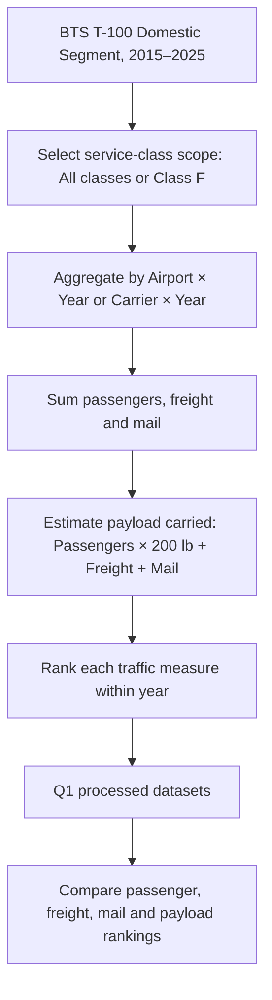

**Processed data samples:**

- [Airport-year, all classes](https://github.com/WebXoX/Info-Viz-Team-Gacha/blob/data-processing/output/samples/q1_airports_year_all_classes_sample.csv)
- [Airport-year, Class F](https://github.com/WebXoX/Info-Viz-Team-Gacha/blob/data-processing/output/samples/q1_airports_year_F_sample.csv)
- [Carrier-year, all classes](https://github.com/WebXoX/Info-Viz-Team-Gacha/blob/data-processing/output/samples/q1_carriers_year_sample.csv)
- [Airport-carrier-year, all classes](https://github.com/WebXoX/Info-Viz-Team-Gacha/blob/data-processing/output/samples/q1_airport_carrier_year_sample.csv)

**Sample data: Scheduled passenger service (Class F), 2025**

| Airport | Passengers | Freight (lb) | Mail (lb) | Passenger Rank |
| :--- | ---: | ---: | ---: | ---: |
| ATL | 44,231,071 | 59,787,347 | 3,034,537 | 1 |
| DEN | 37,693,948 | 38,690,078 | 4,324,598 | 2 |
| DFW | 35,110,013 | 37,608,346 | 4,468,268 | 3 |
| ORD | 33,567,189 | 32,973,613 | 13,178,225 | 4 |
| LAX | 24,889,067 | 221,181,428 | 14,289,140 | 5 |

The table displays existing Class F passenger rankings. Estimated payload and its rankings still need to be calculated from the full aggregated datasets.

The Q1 processing pipeline has been updated to calculate estimated payload carried using passengers × 200 lb + freight + mail. The processed datasets now include estimated payload values and their corresponding rankings for airports and carriers. Rankings are calculated within each year using the full aggregated datasets before extracting the 100-row samples.

**Visualization sketches:**

**Figure 1: Airport ranking comparison (2015, all service classes)**

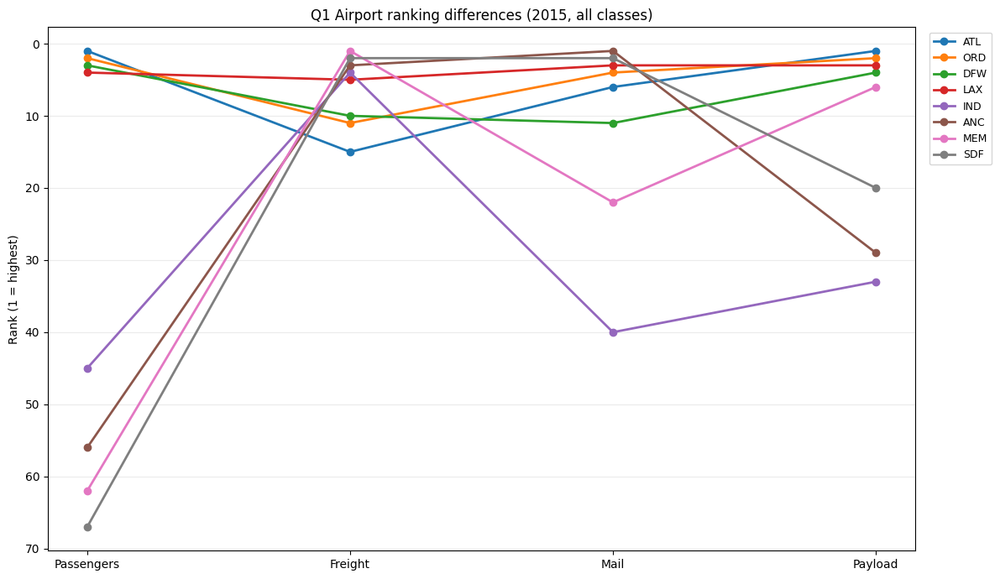

The chart compares airport rankings across passengers, freight, mail, and estimated payload carried.

Airports such as Atlanta (ATL) rank highly in passenger traffic, while Memphis (MEM) and Anchorage (ANC) rank considerably higher in freight than in passengers.

This demonstrates that airports serving the most passengers are not necessarily the largest freight or mail transportation centers.

**Figure 2: Carrier ranking comparison (2015, all service classes)**

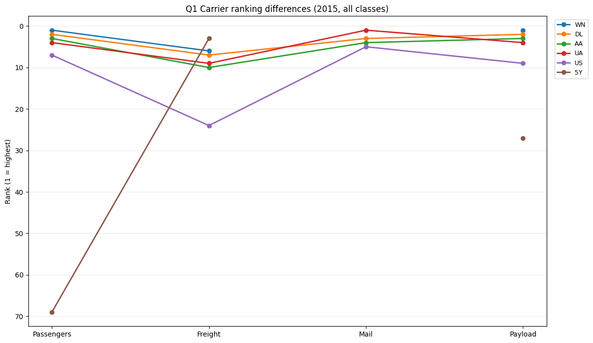

The chart compares airline rankings across the same four measures.

Passenger-focused carriers such as Southwest (WN) rank highly in passenger traffic, while cargo-focused carriers such as FedEx (FX) and UPS (5X) show substantially different ranking patterns.

This comparison highlights how airlines specialize in different transportation activities.

**Proposed visual encoding and interaction:**

We propose two interactive bump charts, one for airports and another for carriers.

- **X-axis:** Passengers, Freight, Mail, and Estimated Payload Carried.
- **Y-axis:** Nationwide ranking, with rank 1 at the top.
- **Lines:** Individual airports or carriers.
- **Default view:** Leading entities selected from the top rankings of each measure.
- **Year selector:** 2015–2025, with 2025 as the default.
- **Entity selection:** Users can search for and compare up to five airports or carriers.
- **Hover:** Displays the exact metric value and corresponding national rank.
- **Highlighting:** Selected entities are emphasized across all four measures.

The rankings are calculated from the complete dataset before filtering the displayed entities, ensuring that selecting an airport or carrier does not change its national ranking.

The visualizations are intended to help users identify differences between passenger hubs, cargo-focused airports, passenger airlines, and freight carriers.

### Q2. How has domestic passenger traffic and capacity changed nationally, by state and airport since 2015, and how did each recover relative to 2019?

**Data transformation:** Aggregate Class F passengers, performed departures and seats by year nationally and airport-year; sum airport values by state when needed. Divide each series by its **own 2019 baseline** (index 100), then compute location share of the same year's national total.

**Samples:** [National annual sample](output/samples/q2_national_year_F_sample.csv) · [Airport-year sample](output/samples/q2_airport_year_F_sample.csv).

| year | passengers | departures_performed | seats | passengers_index_2019 |
| --- | --- | --- | --- | --- |
| 2,015 | 705,333,022 | 8,059,689 | 854,251,386 | 86.18 |
| 2,016 | 728,600,334 | 8,183,844 | 891,798,527 | 89.02 |
| 2,017 | 750,077,053 | 8,176,047 | 917,331,095 | 91.65 |
| 2,018 | 785,574,495 | 8,398,404 | 958,559,533 | 95.99 |
| 2,019 | 818,425,865 | 8,594,870 | 992,344,460 | 100.00 |

**Processing flow:**

**Visualization sketches:**

**Figure 1: National traffic and capacity recovery (2015–2025)**

The line chart compares national passenger segments, available seats, and performed departures from 2015 to 2025, using 2019 as the baseline (index = 100).

Passenger activity experienced the sharpest decline in 2020, falling to approximately 42% of its 2019 level. By 2025, passenger activity and available seats had exceeded their pre-pandemic levels, while performed departures remained below the 2019 baseline.

This comparison illustrates how passenger demand, seating capacity, and flight frequency recovered at different rates.

**Figure 2: State-level passenger recovery comparison**

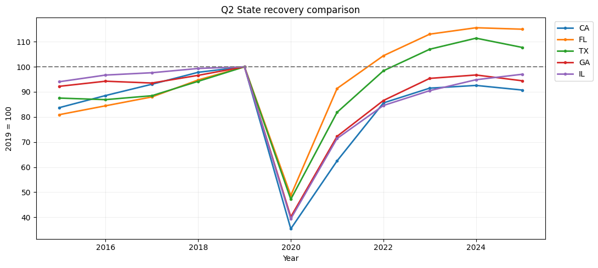

The chart compares passenger recovery across California, Florida, Texas, Georgia, and Illinois, with each state's 2019 passenger total normalized to 100.

The results show that recovery has varied geographically. Florida and Texas exceeded their 2019 passenger activity by 2025, while California, Georgia, and Illinois remained below their respective baselines.

**Figure 3: State contribution to national passenger activity (2025)**

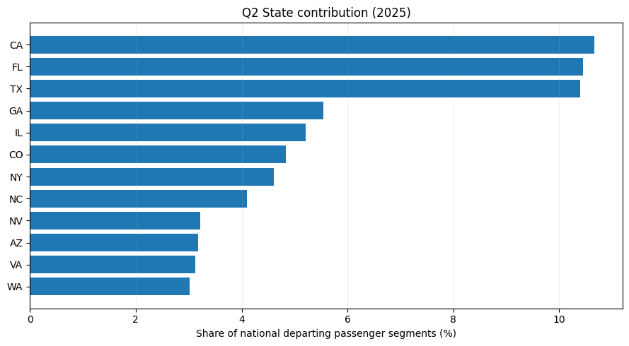

The horizontal bar chart ranks states by their share of national departing passenger segments in 2025.

California, Florida, and Texas account for the largest shares among the displayed states.

Unlike the recovery charts, this visualization compares the relative size of state-level passenger activity rather than growth from 2019.

**Proposed visual encoding and interaction:**

We propose three linked visualizations:

1. A national line chart comparing passengers, available seats, and performed departures relative to 2019.
2. A state or airport recovery line chart comparing selected locations over time.
3. A horizontal bar chart showing each selected state or airport's contribution to national passenger activity.

The final interactive dashboard will provide filtering options for:

- **Year:** Select a year or period from 2015–2025.
- **Geographic level:** Switch between national, state, and airport views where applicable.
- **State and airport:** Search for and compare specific locations.
- **Traffic measure:** Select passengers, available seats, or performed departures.
- **Top-N selection:** Adjust the number of states or airports displayed.

Hovering over a data point will display the location, year, actual traffic value, and its index relative to 2019.

All recovery comparisons will use a consistent 2019 baseline of 100, allowing users to compare the recovery of different locations and traffic measures.

### Q3. How does domestic passenger activity compare with state population, and does Georgia stand out?

**Data transformation:** Sum Class F *originating* passenger segments across airports in each state-year. Join same-year Census state population by two-letter state code; calculate `departing_segments_per_resident = passengers / population`. Compare the **50 states plus D.C.** only. Territories remain in raw traffic data but are excluded from the population-based ranking where comparable annual estimates are unavailable.

**Sample:** [State-year activity and population sample](output/samples/q3_state_year_sample.csv).

| state | year | passengers | population | departing_segments_per_resident |
| --- | --- | --- | --- | --- |
| AK | 2,025 | 5,163,463 | 737,270 | 7.00 |
| AL | 2,025 | 3,133,264 | 5,193,088 | 0.60 |
| AR | 2,025 | 2,475,582 | 3,114,791 | 0.79 |
| AZ | 2,025 | 26,898,153 | 7,623,818 | 3.53 |
| CA | 2,025 | 90,130,069 | 39,355,309 | 2.29 |

**Processing flow:**
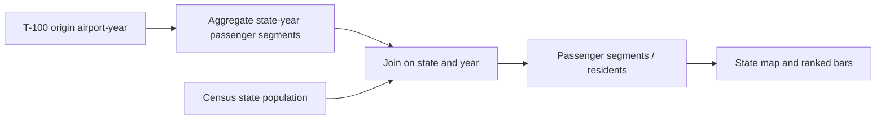

*
**Visualization sketch:**

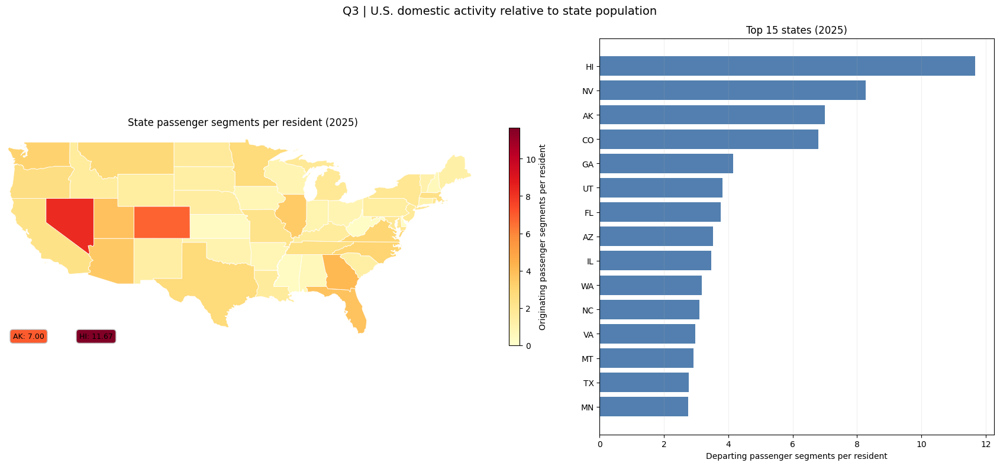

**Figure 1: Domestic passenger activity relative to state population (2025)**

The visualization combines a U.S. choropleth map with a ranked horizontal bar chart to compare domestic departing passenger segments relative to state population.

The metric is calculated as:

`Departing passenger segments per resident = Total originating passenger segments / State population`

The map uses a sequential color scale to represent passenger activity relative to population. Darker shades indicate higher values, while the bar chart ranks the top 15 states.

The initial results show that Hawaii (11.67), Nevada (8.26), and Alaska (7.00) have particularly high passenger activity relative to their populations. Georgia ranks fifth among the states shown, suggesting that its aviation activity is substantial relative to its resident population.

This measure reflects airport activity rather than the number of flights taken by individual residents, as it includes visitors and connecting passengers.

**Proposed visual encoding and interaction:**

We propose two linked visualizations:

1. A U.S. choropleth map showing originating passenger segments per resident for each state.
2. A horizontal bar chart ranking states by the same measure.

The final interactive dashboard will include:

- **Year selector:** 2015–2025.
- **State selection:** Click a state to highlight it across both visualizations.
- **Airport breakdown:** View individual airports within the selected state.
- **Hover tooltips:** Display state name, population, originating passenger segments, and segments per resident.
- **Top-N filter:** Adjust the number of states shown in the ranking.

Georgia will be highlighted to support the research question, while Alaska and Hawaii will be incorporated into the map using geographic insets in the final implementation.

The linked views will allow users to examine geographic differences and compare states with different population sizes.

### Q4. How have nonstop routes changed since 2015, and which airports gained or lost the most destinations?

**Comparison:** One measure (number of active nonstop destinations) compared across airports between 2015 and a later year.

**Unit of observation:** One origin airport in one year.

**Why a 2015-versus-later-year comparison and not a line chart:** The question asks "which airports gained or lost the most", which is a ranking of change between two points. Drawing about 650 airport lines over 11 years would make that ranking unreadable, and highlighting a few lines would hide most airports. The time dimension is kept through the year selector (any year from 2016 to 2025 can be compared with 2015) and through the nationwide header numbers for every year, which show, for example, the 2020 dip in routes.

**Data transformation:**

- Source: T-100 Domestic Segment, scheduled passenger service (Class F), complete years 2015-2025.
- Sum performed departures by year, origin airport, and destination airport.
- Keep a route as active only if it has at least 52 departures in that year (about one a week), so one-off or charter flights do not count as service.
- Routes are directional: an airport's nonstop destinations are the distinct airports it flies to.
- Count distinct active destinations per airport and year (`nonstop_destinations`).
- Attach each airport's 2015 count and compute `change_from_2015` and `pct_change_from_2015`.
- Gainers and losers only use airports with active service in both years (619 airports for 2015 vs. 2025). Airports with service in only one of the two years (37 new in 2025, 44 no longer served) are counted separately as "not comparable", never as zero.
- Nationwide table (header of the chart): for each year, the sum of `nonstop_destinations` over all airports (number of active directional routes), its change from 2015, and how many airports are new or gone compared with 2015.

**Processing flow:**

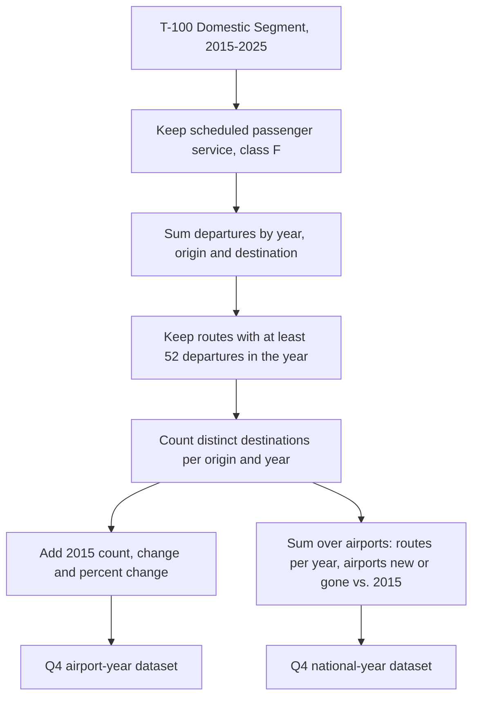

**Processed data samples:** The two tables below are the data behind the default view (2025 vs. 2015).

- Airports (20 rows): [q4_destinations_airport_year_sample.csv](output/samples/q4_destinations_airport_year_sample.csv), the 10 biggest gainers and the 10 biggest losers. The full airport-year table has every airport and every year, so the year selector reuses the same columns.
- Nationwide, complete (11 rows): [q4_national_year_sample.csv](output/samples/q4_national_year_sample.csv), the header numbers.

**Sample 1: Biggest gainers and losers in active nonstop destinations (2025 vs. 2015)**

| Year | Airport | City | Nonstop Destinations | 2015 Destinations | Change in Destinations | Percent Change |
| ----: | :---- | :---- | ----: | ----: | ----: | ----: |
| 2025 | BNA | Nashville, TN | 101 | 49 | +52 | +106.1% |
| 2025 | SRQ | Sarasota/Bradenton, FL | 59 | 9 | +50 | +555.6% |
| 2025 | DEN | Denver, CO | 191 | 147 | +44 | +29.9% |
| 2025 | PHX | Phoenix, AZ | 123 | 80 | +43 | +53.8% |
| 2025 | DFW | Dallas/Fort Worth, TX | 192 | 150 | +42 | +28.0% |
| 2025 | CHS | Charleston, SC | 50 | 21 | +29 | +138.1% |
| 2025 | HVN | New Haven, CT | 30 | 1 | +29 | +2900.0% |
| 2025 | MCO | Orlando, FL | 107 | 79 | +28 | +35.4% |
| 2025 | AUS | Austin, TX | 68 | 41 | +27 | +65.9% |
| 2025 | RDU | Raleigh/Durham, NC | 65 | 40 | +25 | +62.5% |
| 2025 | WFB | Ketchikan, AK | 8 | 12 | -4 | -33.3% |
| 2025 | ADQ | Kodiak, AK | 7 | 11 | -4 | -36.4% |
| 2025 | BLI | Bellingham, WA | 6 | 10 | -4 | -40.0% |
| 2025 | IAH | Houston, TX | 111 | 116 | -5 | -4.3% |
| 2025 | ACY | Atlantic City, NJ | 6 | 11 | -5 | -45.5% |
| 2025 | LBE | Latrobe, PA | 2 | 7 | -5 | -71.4% |
| 2025 | JHM | Kapalua, HI | 1 | 6 | -5 | -83.3% |
| 2025 | TTN | Trenton, NJ | 5 | 12 | -7 | -58.3% |
| 2025 | OAK | Oakland, CA | 30 | 39 | -9 | -23.1% |
| 2025 | DTW | Detroit, MI | 99 | 111 | -12 | -10.8% |

**Sample 2: Nationwide active nonstop routes**

| Year | Airports With Service | Active Nonstop Routes | Change vs. 2015 | Percent Change | New vs. 2015 | Gone vs. 2015 |
| :---- | ----: | ----: | ----: | ----: | ----: | ----: |
| 2015 | 663 | 6,324 | 0 | 0.0% | 0 | 0 |
| 2016 | 669 | 6,493 | +169 | +2.7% | 16 | 10 |
| 2017 | 658 | 6,576 | +252 | +4.0% | 18 | 23 |
| 2018 | 652 | 6,805 | +481 | +7.6% | 23 | 34 |
| 2019 | 653 | 6,983 | +659 | +10.4% | 24 | 34 |
| 2020 | 647 | 6,595 | +271 | +4.3% | 27 | 43 |
| 2021 | 649 | 7,088 | +764 | +12.1% | 28 | 42 |
| 2022 | 658 | 7,194 | +870 | +13.8% | 34 | 39 |
| 2023 | 659 | 7,200 | +876 | +13.9% | 35 | 39 |
| 2024 | 659 | 7,457 | +1,133 | +17.9% | 34 | 38 |
| 2025 | 656 | 7,773 | +1,449 | +22.9% | 37 | 44 |

**Visualization sketch:**

**Figure 1: Change in active nonstop destinations, 2025 vs. 2015**

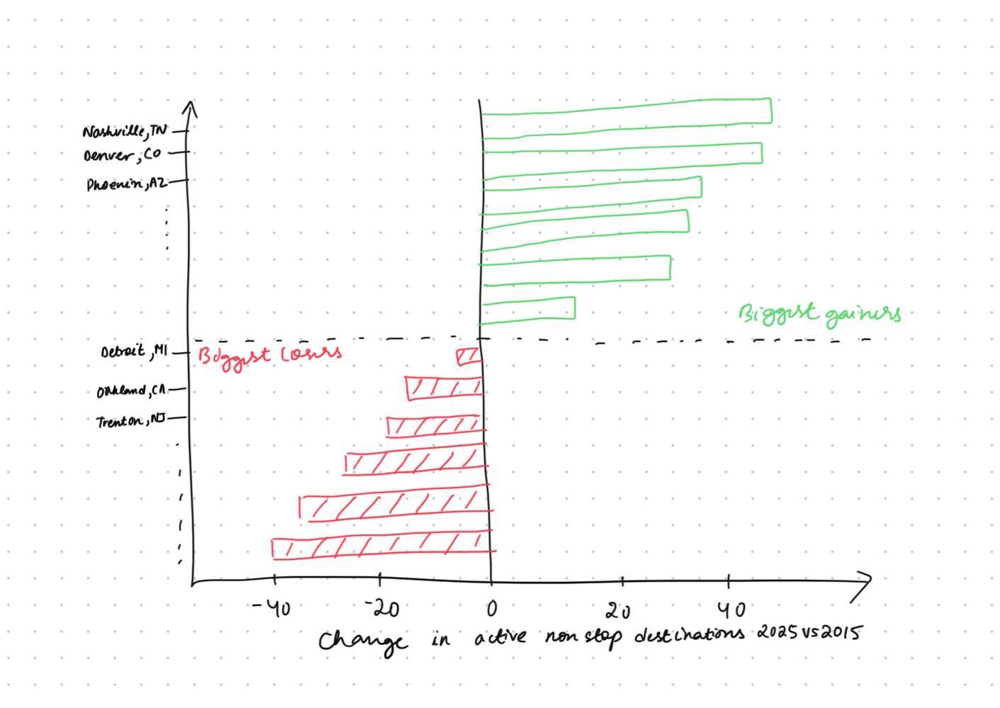

**Proposed visualization (one view): diverging ranked bar chart.**

- **Rows:** The 10 biggest gainers (top) and 10 biggest losers (bottom), sorted by change.
- **Horizontal axis:** Change in nonstop destinations since 2015, one shared scale centered on 0, so gains and losses are directly comparable.
- **Encoding:** Direction is encoded by bar position and a +/- sign in the label, not by color alone (gainers are drawn solid and losers hatched in the sketch). Each bar is labeled with the two counts (for example "49 to 101").
- **Header text** (from the nationwide table): active routes in 2015 vs. the selected year, and how many airports are "not comparable".
- **Interaction:** A year selector (2016-2025) compares that year with 2015. Hovering a bar shows the city, both counts, and the percent change.

### Q5. Do small airports follow different trends than major hubs, and has traffic concentrated at the busiest airports?

**Comparison:** One measure (share of national passengers) over time, compared across three airport-size tiers and the top 10 busiest airports. The change since 2015 is what is drawn.

**Unit of observation:** One tier (or the top-10 set) in one year.

**Definitions:** "Major hubs" are large hubs and "small airports" are small hubs and non-hubs combined. The tiers follow the FAA hub categories, applied to each year separately: large hub is 1% or more of national passengers, medium hub is 0.25% to under 1%, and small hub (0.05% to under 0.25%) and non-hub (under 0.05%) are merged into "small & non-hub". An airport can move between tiers from year to year. The FAA bases its categories on enplanements; we use T-100 origin passengers (passenger segments), the closest measure we have, so the tiers are an approximation of the official ones.

**Data transformation:**

- Source: T-100 Domestic Segment, scheduled passenger service (Class F), 2015-2025. Passengers are counted at the origin airport (passenger segments, so a connecting traveler counts on each leg).
- Sum passengers per airport and year, and compute each airport's share of that year's national passengers.
- Assign every airport a tier in every year from that year's share (large hub 1% or more; medium hub 0.25% to under 1%; small & non-hub under 0.25%). Nothing is fixed from an earlier year.
- Rank airports by passengers within each year and take the 10 busiest of that year (the set of 10 can change from year to year; it overlaps the large hubs and is not an extra tier).
- For each year and series (three tiers plus the top-10 set), sum passengers, count airports, and compute the share of national passengers.
- Compute the change in share since 2015 in percentage points (`share_change_from_2015_pp`). This is what the chart draws, because the shares themselves move by only 1-2 points.
- Caveat: tier membership changes, so a tier's passenger total mixes real growth with airports moving in or out. This is why the chart uses shares, not passenger counts. 14 of the 663 airports that have passengers in both 2015 and 2025 are in a different tier in 2025 than in 2015.

**Processing flow:**

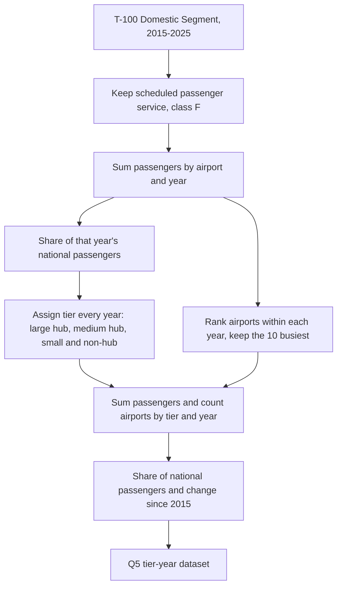

**Processed data samples:**

- Tier-year (all 44 rows): [q5_group_year_sample.csv](output/samples/q5_group_year_sample.csv). This is the complete data behind the chart (11 years x 4 series); three years are shown below.
- Airport-year tier assignments (15 rows): [q5_airport_year_tier_sample.csv](output/samples/q5_airport_year_tier_sample.csv). The full table assigns a tier to every airport in every year.

**Sample: Tier shares of national passengers (2015, 2020, 2025)**

| Year | Series | Airport Count | Passengers | Share of National Passengers | Change in Share vs. 2015 (pp) |
| ----: | :---- | ----: | ----: | ----: | ----: |
| 2015 | Large hub | 29 | 482,805,322 | 68.45% | +0.00 |
| 2015 | Medium hub | 34 | 135,230,908 | 19.17% | +0.00 |
| 2015 | Small & non-hub | 700 | 87,296,792 | 12.38% | +0.00 |
| 2015 | Top 10 busiest airports | 10 | 254,091,942 | 36.02% | +0.00 |
| 2020 | Large hub | 29 | 227,874,186 | 66.98% | -1.47 |
| 2020 | Medium hub | 39 | 69,913,804 | 20.55% | +1.38 |
| 2020 | Small & non-hub | 623 | 42,422,579 | 12.47% | +0.09 |
| 2020 | Top 10 busiest airports | 10 | 127,909,880 | 37.60% | +1.58 |
| 2025 | Large hub | 32 | 579,382,922 | 68.55% | +0.10 |
| 2025 | Medium hub | 40 | 161,732,077 | 19.14% | -0.03 |
| 2025 | Small & non-hub | 640 | 104,069,647 | 12.31% | -0.07 |
| 2025 | Top 10 busiest airports | 10 | 293,684,684 | 34.75% | -1.27 |

**Visualization sketch:**

**Figure 1: Change in share of national passengers since 2015**

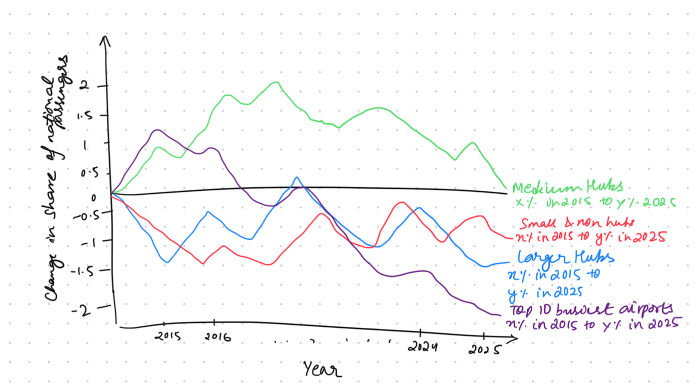

**Proposed visualization (one view): line chart of the change in share of national passengers since 2015.**

- **Axes:** Horizontal axis is year (2015-2025). Vertical axis is the change in share of national passengers since 2015, in percentage points, with a zero line (the 2015 level). Raw shares (68%, 19%, 12%, 35%) would draw four nearly flat lines; the change since 2015 makes the differences visible, and the labels still give the actual shares.
- **Lines:** Large hub, medium hub, small & non-hub, and the top 10 busiest airports. Each line has its own line style and marker and a direct label at its right end ("68.5% in 2015 to 68.5% in 2025", airport count), so lines can be told apart without color alone. The top-10 line is dotted because it overlaps the large hubs.
- **How to read it:** A rising top-10 line means traffic concentrated at the busiest airports. A rising small & non-hub line means smaller airports gained ground. Lines moving together mean they follow the same trend.
- **Footnote on the chart:** Tier definitions, that tiers are re-assigned every year, and that small hubs and non-hubs are merged.
- **Interaction:** Hovering a point shows the series, year, airport count, passengers, share, and change since 2015. Clicking a legend entry hides or shows that line.

### Q6. Did on-time performance keep pace with traffic, and which airports and carriers are most delay-prone, when, and why?

**Comparison:** Two views, because the question has two parts. View 1 compares busy airports on the change in traffic against the change in on-time rate between two years (kept pace or not). View 2 ranks airports (or carriers) on delay minutes per flight and splits each bar by cause, with the worst month shown (which, why, when).

**Unit of observation:** View 1: one busy airport (2018 compared with 2025). View 2: one destination airport (or one reporting carrier) in 2025.

**What counts as a "busy" airport:** A large or medium hub in 2025 according to the Q5 tiers, meaning at least 0.25% of national passengers (72 airports). This reuses the Q5 definition, so the two questions agree on what is busy, and it guarantees enough flights for stable rates (the smallest of these airports has about 18,000 scheduled flights in 2025). The same airports are used for both views.

**Data transformation:**

- Source: BTS Reporting Carrier On-Time Performance, 132 monthly files (2015-2025), read in chunks. 2026 is excluded (partial). Traffic comes from T-100 Class F performed departures, the same source as Q4 and Q5.
- A flight counts only if it was not cancelled, not diverted, and has a recorded arrival delay. A missing delay is never treated as zero.
- On time means arriving less than 15 minutes after schedule. Arrival delay is attributed to the destination airport, where the flight actually landed late.
- Aggregate to destination airport x carrier x month keeping counts and delay minutes (not averages), then roll up to airport x year, airport x month, and carrier x month. Rates are always ratios of sums, so they are correctly weighted.
- Busy airports: large or medium hub in 2025 (Q5 tiers).
- View 1: For each busy airport, traffic = T-100 performed departures at that airport in 2018 and 2025; on-time rate = on-time flights / valid flights in each year. Compute the percent change in traffic and the change in on-time rate in percentage points.
- View 1 uses 2018 as the starting year, not 2015, because in 2018 the BTS cutoff for which airlines must report on-time data dropped from 1% to 0.5% of domestic revenue, so more airlines report from 2018 on. Comparing years with the same rules keeps the change from being a reporting artifact.
- View 1 keeps an airport only if at least 50% of its T-100 flights have valid on-time data in both years (this excludes Anchorage, so 71 of the 72 busy airports are drawn). The on-time rate describes the airlines that report, not every flight.
- View 2: For 2025, sum the five BTS delay-cause minutes (carrier, weather, air traffic system, security, late aircraft) and divide by valid flights to get delay minutes per flight, in total and by cause. BTS reports causes only for flights that arrived 15 or more minutes late, and they describe the flight, not where the delay started (late aircraft means an earlier flight was already late).
- View 2: Rank airports by total delay minutes per flight (the 15 highest are drawn). For the worst month, compute the same measure for each calendar month of 2025 (months with at least 500 valid flights) and keep the highest.
- View 2 carriers: The same measures per reporting carrier, for carriers with at least 50,000 valid flights in 2025 (14 carriers).

**Processing flow:**

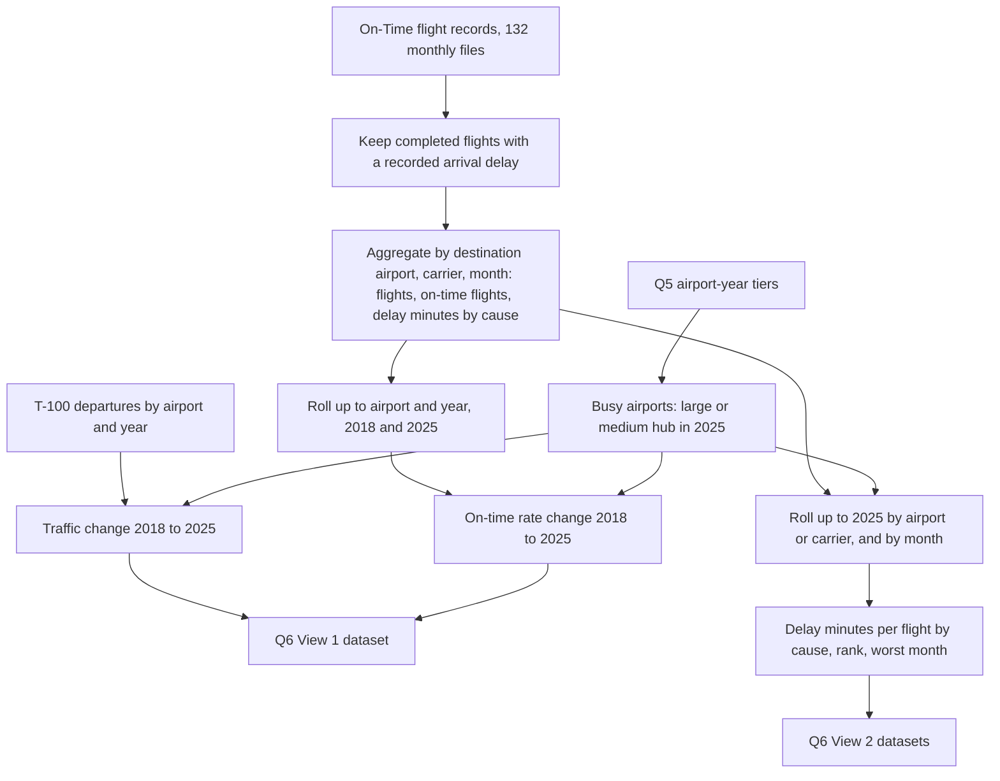

**Processed data samples:**

- View 1: [q6_airport_change_sample.csv](output/samples/q6_airport_change_sample.csv), all 71 airports drawn (the whole table is the data behind the scatterplot). Eight airports are shown below: the labeled outliers and the biggest drop.
- View 2, airports: [q6_airport_delays_sample.csv](output/samples/q6_airport_delays_sample.csv), the 15 airports drawn by default (all 72 busy airports are in the full table). Cause columns are minutes per flight.
- View 2, carriers (shown when the switch is set to carriers): [q6_carrier_delays_sample.csv](output/samples/q6_carrier_delays_sample.csv), all 14 carriers, same columns as the airport table.

**Sample 1: View 1, traffic change vs. on-time rate change (2018 vs. 2025)**

| Airport | Tier in 2025 | Flights 2018 | Flights 2025 | Traffic Change | On-Time 2018 | On-Time 2025 | On-Time Change (pp) |
| :---- | :---- | ----: | ----: | ----: | ----: | ----: | ----: |
| DCA | Large hub | 139,657 | 141,637 | +1.4% | 80.46% | 71.64% | -8.82 |
| SAN | Large hub | 95,373 | 98,932 | +3.7% | 82.45% | 75.52% | -6.93 |
| DEN | Large hub | 271,377 | 323,204 | +19.1% | 83.02% | 76.42% | -6.60 |
| SRQ | Medium hub | 6,479 | 18,294 | +182.4% | 83.62% | 77.86% | -5.76 |
| DTW | Large hub | 174,274 | 141,903 | -18.6% | 85.12% | 80.51% | -4.61 |
| LAX | Large hub | 253,572 | 198,252 | -21.8% | 81.75% | 81.20% | -0.55 |
| SFO | Large hub | 180,053 | 148,509 | -17.5% | 74.80% | 75.89% | +1.09 |
| EWR | Large hub | 157,365 | 129,365 | -17.8% | 69.05% | 72.78% | +3.73 |

In the 71-airport sample, the on-time rate fell between 2018 and 2025 for 68 airports.

**Sample 2: View 2, most delay-prone busy airports (2025)**

| Rank | Airport | Valid Flights | On-Time Rate | Delay Min per Flight | Airline | Late Aircraft | Air Traffic System | Weather | Security | Worst Month | Worst-Month Min per Flight |
| :---- | :---- | ----: | ----: | ----: | ----: | ----: | ----: | ----: | ----: | :---- | ----: |
| 1 | EWR | 116,774 | 72.78% | 24.67 | 4.39 | 5.88 | 13.31 | 1.10 | 0.01 | May | 53.5 |
| 2 | DCA | 136,407 | 71.64% | 22.98 | 5.95 | 9.20 | 6.34 | 1.46 | 0.02 | Jul | 36.0 |
| 3 | DFW | 305,342 | 75.25% | 22.39 | 7.21 | 8.89 | 4.03 | 2.23 | 0.02 | Jul | 28.7 |
| 4 | PHL | 95,258 | 75.49% | 21.67 | 7.15 | 10.03 | 3.50 | 0.96 | 0.02 | Jul | 36.0 |
| 5 | ORD | 320,097 | 74.62% | 21.19 | 6.44 | 7.41 | 5.85 | 1.48 | 0.01 | Dec | 33.2 |
| 6 | LGA | 130,999 | 73.86% | 20.63 | 5.44 | 6.42 | 7.66 | 1.09 | 0.03 | Jul | 30.0 |
| 7 | BOS | 140,277 | 73.90% | 19.70 | 5.02 | 7.01 | 6.95 | 0.70 | 0.02 | Jul | 27.8 |
| 8 | PBI | 30,234 | 72.27% | 19.38 | 5.38 | 7.35 | 5.84 | 0.78 | 0.03 | Jun | 28.5 |
| 9 | SJU | 35,323 | 73.24% | 18.74 | 6.98 | 6.70 | 4.21 | 0.82 | 0.03 | Aug | 25.5 |
| 10 | JFK | 102,172 | 77.34% | 18.62 | 5.74 | 6.29 | 5.85 | 0.71 | 0.03 | Jul | 31.5 |
| 11 | CVG | 32,904 | 75.05% | 18.16 | 5.38 | 8.73 | 2.70 | 1.30 | 0.04 | Jul | 27.8 |
| 12 | MIA | 110,193 | 76.80% | 18.11 | 5.93 | 7.18 | 4.02 | 0.96 | 0.03 | Jul | 28.4 |
| 13 | BUF | 20,186 | 73.54% | 17.94 | 5.73 | 8.45 | 2.62 | 1.09 | 0.05 | Jul | 28.4 |
| 14 | MCO | 157,555 | 75.84% | 17.86 | 4.92 | 7.09 | 5.15 | 0.68 | 0.02 | Jul | 26.6 |
| 15 | FLL | 86,187 | 75.52% | 17.69 | 5.07 | 6.77 | 5.06 | 0.75 | 0.04 | Dec | 25.7 |

**Sample 3: View 2, carriers with the most delay minutes per flight (2025), top five of 14**

| Rank | Carrier | Valid Flights | On-Time Rate | Delay Min per Flight | Worst Month |
| :---- | :---- | ----: | ----: | ----: | :---- |
| 1 | OH PSA Airlines Inc. | 236,682 | 72.47% | 25.07 | Jun |
| 2 | F9 Frontier Airlines Inc. | 194,192 | 72.09% | 23.56 | Jun |
| 3 | AA American Airlines Inc. | 952,841 | 74.29% | 21.42 | Jul |
| 4 | G4 Allegiant Air | 129,892 | 75.03% | 21.32 | Jul |
| 5 | B6 JetBlue Airways | 226,703 | 73.85% | 19.91 | Jul |

**Visualization sketches:**

**Figure 1: View 1, change in traffic vs. change in on-time rate (2018 vs. 2025)**

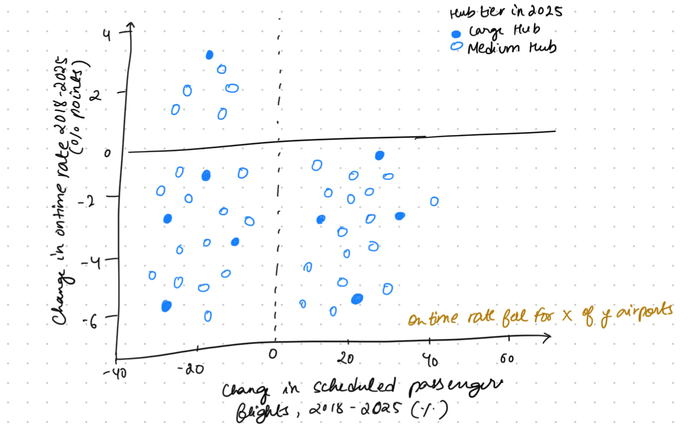

**Figure 2: View 2, delay minutes per arriving flight by cause (2025)**

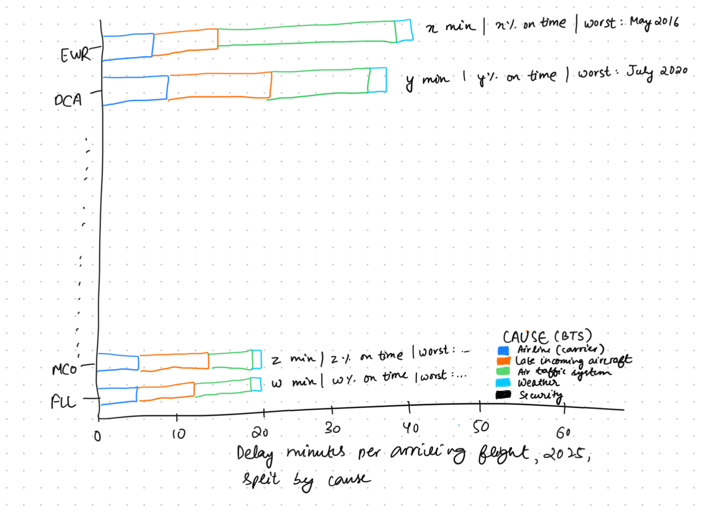

Note: The "worst" annotations in the View 2 sketch (for example "May 2016" and "July 2020") are placeholder text. In the data, the worst month is the highest delay-minutes-per-flight month within 2025 only (for example EWR: May, 53.5 minutes per flight).

**Proposed visualization (two views, because the question has two parts: a before-and-after comparison, and a ranking with causes and timing):**

- **View 1 - scatterplot (did performance keep pace with traffic).**
  - One dot per busy airport. Horizontal axis: change in scheduled passenger flights, 2018 to 2025 (%). Vertical axis: change in on-time rate, in percentage points, with a zero line. The area below it is shaded and marked "on-time rate fell".
  - Large hubs are filled dots and medium hubs are hollow dots (shape fill, not color alone). The biggest movers are labeled (for example DCA, DEN, DTW, EWR, SFO). An extreme point such as SRQ (+182% traffic) is drawn at the edge with an arrow and its value instead of stretching the axis.
  - A text note counts how many airports fell below zero (68 of 71 in the current data). If performance had kept pace, dots would not sit below the line regardless of traffic.
  - Interaction: Hovering a dot shows the airport, both years' flights, and on-time rates.
- **View 2 - ranked stacked horizontal bars (which airports or carriers, why, and when).**
  - One bar per airport (15 most delay-prone busy airports), longest at the top. Bar length is delay minutes per flight in 2025, split into the five BTS causes (airline, late incoming aircraft, air traffic system, weather, security) with a legend. Segments always appear in the same order, so one cause can be compared across bars.
  - Text at the end of each bar: total minutes per flight, on-time rate, and the worst month of 2025 with its minutes per flight.
  - A switch changes the rows from airports to carriers (same encoding).
  - Interaction: Hovering a bar shows the flights, on-time rate, minutes per flight for each cause, and the worst month.

### Q7. Where do capacity and connectivity indicators suggest potential mismatch?

**Data transformation:** Join Class F airport-year passenger/seat totals with Q4 distinct-destination counts on `year` + `airport_id`. Compute `seats_per_destination`, `passengers / seats` and `100 × destinations / destinations_2019`. Optional annual mean signed arrival delay should be shown only where the On-Time airport-year join is coverage-validated; report missing values as unavailable. Carrier seat shares would require a separately matched **Class F** airport–carrier–year table (not present in current processed sample bundle).

**Processed data samples:**

- [Airport-year capacity and connectivity sample](https://github.com/WebXoX/Info-Viz-Team-Gacha/blob/data-processing/output/samples/q7_airport_year_exploratory_sample.csv)
- [Annual delay data coverage](https://github.com/WebXoX/Info-Viz-Team-Gacha/blob/data-processing/output/samples/q7_delay_join_coverage_by_year_sample.csv)

**Sample 1: Airport capacity, connectivity and delays (2015)**

| Airport | Available Seats | Passengers | Seat Utilization | Nonstop Destinations | Connectivity Index (2019 = 100) | Avg. Arrival Delay (min) |
|---|---:|---:|---:|---:|---:|---:|
| ATL | 51,813,821 | 44,319,480 | 85.5% | 200 | 105.8 | 2.42 |
| ANC | 3,279,828 | 2,452,425 | 74.8% | 70 | 107.7 | -0.48 |
| ABQ | 2,971,846 | 2,423,538 | 81.5% | 75 | 98.7 | 4.41 |
| ALB | 1,506,571 | 1,282,295 | 85.1% | 51 | 87.9 | -2.25 |
| ABE | 373,440 | 323,027 | 86.5% | 28 | 71.8 | 6.28 |

Seat utilization is calculated as passengers divided by available seats. Connectivity recovery compares each year's nonstop destination count with the airport's 2019 count.

The displayed arrival delays are from airport-years with complete matching On-Time reporting data.

**Sample 2: On-Time data coverage**

| Year | T-100 Airport-Years | Complete Matched Airport-Years | Coverage |
|---|---:|---:|---:|
| 2015 | 787 | 299 | 37.99% |
| 2019 | 731 | 338 | 46.24% |
| 2020 | 710 | 333 | 46.90% |
| 2023 | 719 | 325 | 45.20% |
| 2025 | 742 | 325 | 43.80% |

The annual coverage table identifies how many airport-years have complete matched arrival-delay data. The remaining airports should be shown as having unavailable delay information rather than zero delay.

**Processing flow:**
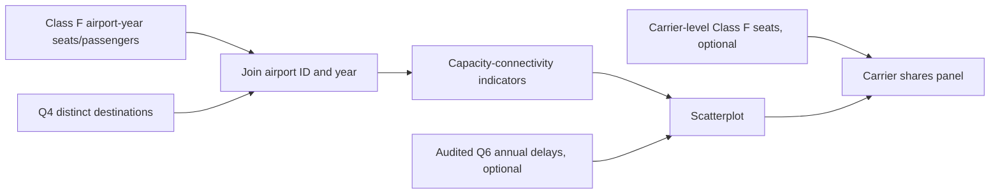

**Visualization sketches:**

**Figure 1: Airport capacity versus connectivity (2025)**

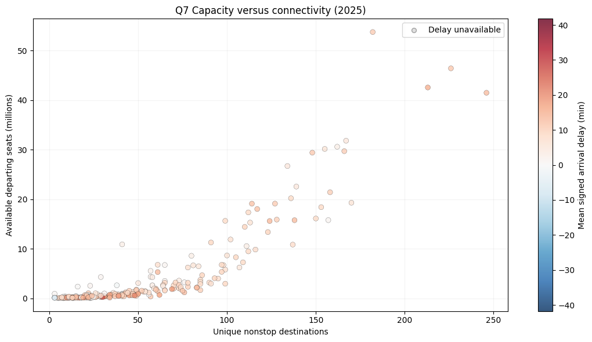

The scatterplot compares airports based on their available departing seats and number of unique nonstop destinations in 2025.

- **X-axis:** Number of unique nonstop destinations.
- **Y-axis:** Available departing seats (millions).
- **Points:** Individual airports.

The visualization shows how airports differ in capacity and connectivity. Airports with similar destination counts may have different levels of seating capacity, suggesting differences in flight frequency, aircraft size, or network structure.

These differences help identify airports that may warrant further investigation.

**Figure 2: Arrival delay history for Atlanta (2015–2025)**

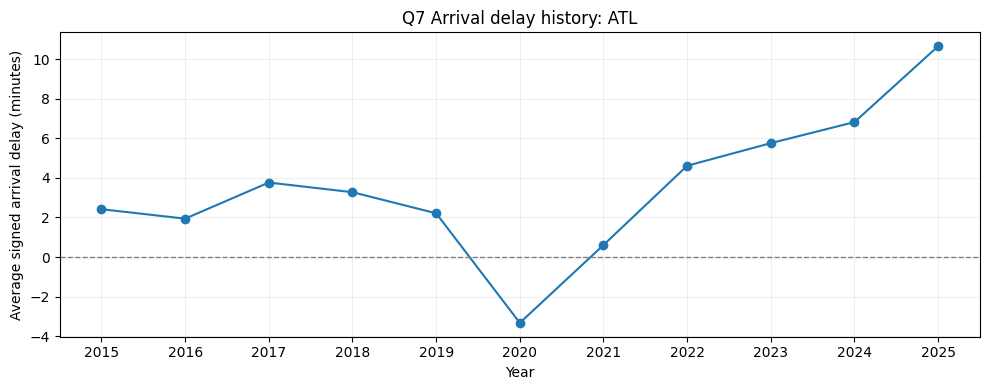

The line chart shows the average signed arrival delay at Atlanta (ATL) between 2015 and 2025.

Average arrival delays increased from approximately 2.2 minutes in 2019 to 10.6 minutes in 2025, while 2020 recorded negative average delays, indicating earlier arrivals on average.

This provides additional operational context when examining airport capacity and connectivity.

**Proposed visual encoding and interaction:**

We propose two linked visualizations:

1. A scatterplot comparing airport capacity and nonstop connectivity.
2. A line chart showing annual arrival delay trends for a selected airport.

The final interactive dashboard will provide:

- **Year filter:** Select a year between 2015 and 2025.
- **State filter:** Display airports within selected states.
- **Airport selection:** Click an airport in the scatterplot to display its historical arrival delays.
- **Hover tooltips:** Display airport name, available seats, passenger volume, nonstop destinations, and connectivity recovery relative to 2019.
- **Connectivity recovery filter:** Highlight airports that have not recovered their 2019 nonstop destination counts.

Delay information will be displayed only where validated data is available. Missing values will be shown as unavailable rather than zero.

These visualizations aim to identify potential differences between airport capacity, network connectivity, and operational performance without assuming that those differences represent proven service gaps.

## 4. Reproducibility and contribution details to finalize

**Repository:** https://github.com/WebXoX/Info-Viz-Team-Gacha (confirm active branch). Place this Markdown at the repo root, and copy the included `output/samples/` and `sketches/` into the same relative paths so links render.

**Reproduction:** Execute the primary EDA/data-processing notebook to produce full `output/processed/*.csv` tables; run the separate static Matplotlib visualization notebook against those full tables. Do not calculate totals from the 100-row samples, which exist only as report previews.

**TODO before submission:** Confirm repository access for instructors, the exact EDA notebook filename and source download versions; verify any 2025 delay joins, full airport-coordinate mapping, and Q5 cutoffs; replace draft sketches with team-original versions where required; complete team member contribution breakdown.

## 5. AI-use disclosure (draft for team confirmation)

ChatGPT was used to help organize and revise the report structure, write/modify Python notebook prototypes, generate 100-row excerpts of already-processed EDA tables, and produce **labeled visualization wireframe drafts**. Team members are responsible for verifying the computations and source data, creating/reviewing the required original submission sketches, interpreting results, and approving final report wording. This statement must be updated to reflect actual team use and repeated in the repository README according to course policy.
